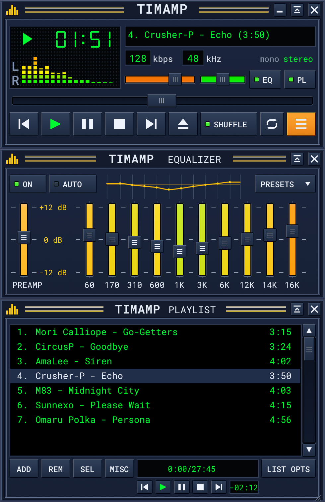

# Timamp — AmpX with custom behaviour

*Modern audio player. Classic spirit.*

A native macOS music player with the Winamp workflow (compact player, equalizer, playlist, visualizer) for local music libraries.

> Timamp is a personal fork of [`ratovarius/ampx`](https://github.com/ratovarius/ampx), built on its 1.1.3 release.
> AmpX is based on a fork of [`mbrukman/winamp-macos`](https://github.com/mbrukman/winamp-macos) (by Matt Greenwood, MIT), a tribute to the original Winamp by Nullsoft.



## What differs from AmpX

- **Files from Finder.** "Open With", a drop on the Dock icon and a double-click add the file to the end of the playlist. It starts playing if the app was launched to open it or the playlist was empty; otherwise playback is left alone. AmpX 1.1.3 answers with a "cannot open files in this format" alert.
- **Startup sound.** It plays only when the app starts with an empty playlist, and never when the app was launched to open a file.
- **More formats.** MPEG-4 audio (AAC and Apple Lossless in `.m4a` and `.m4b`), raw AAC and AIFF play next to MP3, FLAC and WAV.
- **Its own name.** The program is called Timamp in the menus, the Dock and the window headers.

[FORK.md](FORK.md) describes each change, how it was tested and what is not covered (in Russian).

## Features

- MP3, FLAC, WAV, MPEG-4 audio (`.m4a`, `.m4b`), AAC and AIFF playback
- Opens files handed over by Finder: "Open With", the Dock icon, a double-click
- 10-band equalizer with presets and Winamp `.eqf` import
- Playlist with M3U load/save, drag and drop, sort and multi-select
- Mini visualizer with 8 modes and color palettes
- Player, Equalizer and Playlist are separate windows that snap together; each collapses to a compact strip
- Media keys and macOS Now Playing


## Quick start

Requires macOS 26.0+ to run. Building needs Xcode 26.4+ and its Metal Toolchain component.

```bash
xcodebuild -downloadComponent MetalToolchain
xcodebuild -project AmpX.xcodeproj -scheme AmpX -configuration Release \
  -destination "platform=macOS,arch=arm64" ONLY_ACTIVE_ARCH=YES -derivedDataPath build build
cp -R build/Build/Products/Release/AmpX.app /Applications/Timamp.app
```

The build product keeps the upstream file name, `AmpX.app`. Copying it as `Timamp.app` gives the program its name in the Dock and in Finder.

## Docs

- [FORK.md](FORK.md): what this fork changes and how it was verified (in Russian)
- [USAGE.md](USAGE.md): how to use the app
- [BUILDING.md](BUILDING.md): build, test, lint
- [RELEASE.md](RELEASE.md): the release process of the original project

## Credits

- [`ratovarius/ampx`](https://github.com/ratovarius/ampx): the project this fork is built on
- [`mbrukman/winamp-macos`](https://github.com/mbrukman/winamp-macos): the upstream project, © 2024 Matt Greenwood
- [Webamp](https://github.com/captbaritone/webamp) ([webamp.org](https://webamp.org/)): reference for the classic Winamp 2.x layout
- Winamp by Nullsoft: the original

## License

MIT.
